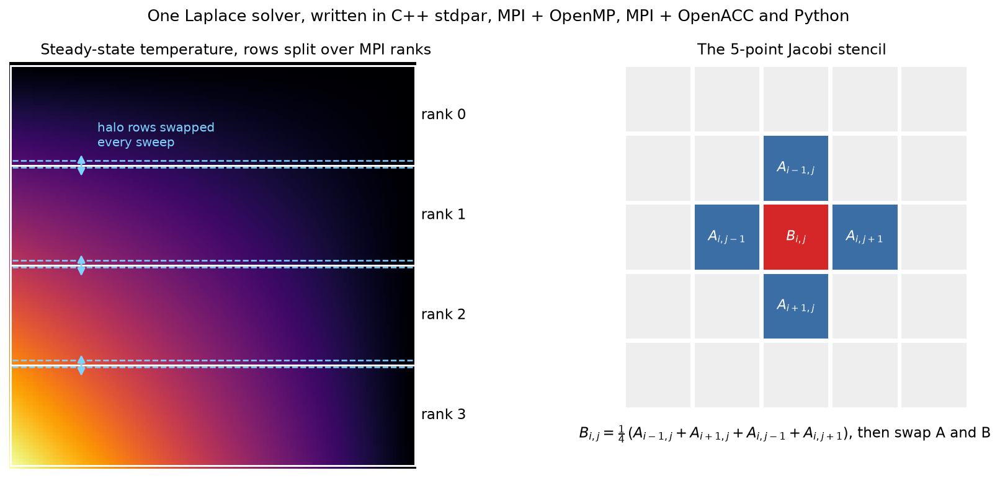
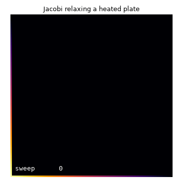
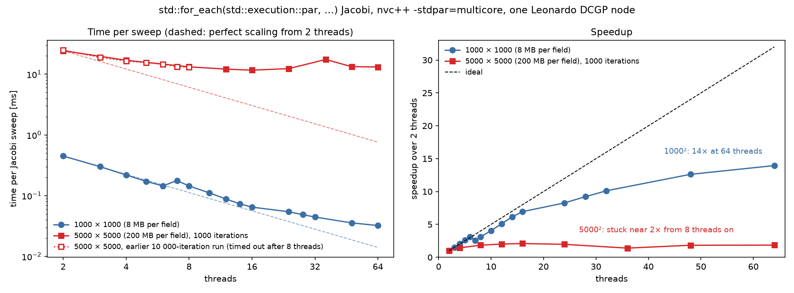

# Jacobi Solver Zoo


<sub>Every solver here computes the same thing: a square plate with fixed temperatures on its edges, relaxed to steady state one Jacobi sweep at a time. In the distributed versions each rank owns a block of rows and swaps its edge rows with its neighbours every sweep.</sub>

The Jacobi method for the Laplace equation is very simple stencil code. Every interior point becomes the average of its four neighbours.

$$B_{i,j} = \tfrac{1}{4}\left(A_{i-1,j} + A_{i+1,j} + A_{i,j-1} + A_{i,j+1}\right), \qquad A \leftrightarrow B,$$

Until the field stops changing. It's a nice way to compare programming models. So in this repo I wrote the same solver four ways.

| Folder | Model | Runs on |
| --- | --- | --- |
| [`stdpar/`](stdpar) | C++20 `std::for_each(std::execution::par, ...)`, with TBB, OpenMP or NVIDIA `nvc++` underneath; a serial version and a GoogleTest that checks they agree | one CPU node (or a GPU with `nvc++ -stdpar=gpu`) |
| [`mpi-openmp/`](mpi-openmp) | hybrid MPI + OpenMP, with the halo exchange overlapped with the interior sweep | many CPU nodes |
| [`mpi-openacc/`](mpi-openacc) | MPI + OpenACC, one GPU per rank, halos sent straight from GPU memory with CUDA-aware MPI | many GPU nodes |
| [`python/`](python) | mpi4py with NumPy slicing (1D and 2D decompositions), plain loops, Numba (`jit`, `njit`, CUDA) and CuPy | CPU or GPU |

and timed them on CINECA's Leonardo. Written for the C++, parallel programming, GPU and Python courses of the [Master in High Performance Computing (MHPC)](https://www.mhpc.it/) at SISSA/ICTP (October to December 2025).

## Repository layout
```
stdpar/inc/ParallelJacobi.hpp      the stdpar solver with one std::for_each(par) over the interior points per sweep
stdpar/inc/SerialJacobi.hpp        the same sweep as two plain loops
stdpar/inc/CMesh.hpp               the (N+2) x (N+2) field pair with fixed edges, printing and .dat output
stdpar/src/PJ.cpp, SJ.cpp          drivers (parallel / serial), append their timings to log.txt
stdpar/test/test_PJvsSJ.cpp        GoogleTest ensuring parallel and serial fields agree
stdpar/CMakePresets.json           TBB_*, OMP_*, NV_* (nvc++ multicore) and NVGPU_* (nvc++ GPU) presets
stdpar/scripts/pjacobi.sh          Slurm thread sweep on one node
stdpar/scripts/make_gif.py         turns the .dat snapshots into a gif (plot_gif.gp does the same with gnuplot)
stdpar/results/                    thread-sweep logs, threads.csv, threads.png, plot_threads.py, jacobi.gif

mpi-openmp/inc/Mesh.hpp            1D row decomposition, uneven splits, halo exchange, gather/print helpers
mpi-openmp/inc/PJacobi.hpp         the solver, has edge rows, post halos, interior rows (OpenMP + SIMD), wait, swap
mpi-openmp/src/PJacobi.cpp         the driver
mpi-openmp/external/               my timing and matrix-printing libraries, as git submodules
mpi-openmp/scripts/pjacobi.sh      build-and-submit helper for Slurm (one job per configuration)

mpi-openacc/inc/Mesh.hpp           the whole OpenACC solver: device data, stencil kernel, CUDA-aware halo exchange
mpi-openacc/src/GPUJacobi.cpp      the driver
mpi-openacc/tools/cuda_aware_test.cpp  checks that MPI can send a device buffer directly
mpi-openacc/scripts/               Slurm scripts: build + Nsight Systems profile, CUDA-awareness check

python/mesh_1D.py, mesh_2D.py      row-block and 2D Cartesian decompositions with non-blocking halo exchange
python/Jacobi_MPIonly_*.py         seven solvers: noslice, slicing_1D, slicing_2D, jit, njit, jit_cuda, cupy
python/main.py                     pick a solver with --variant; mpi_timer.py reports the max time over ranks
python/compare_variants.py         checks every CPU solver against a serial NumPy solve, on any number of ranks
python/job.slurm                   Slurm script for one GPU
```

The MPI + OpenMP version times itself with [myMPITimer](https://github.com/sjshamsi/myMPITimer) and prints with [myMatrixPrint](https://github.com/sjshamsi/myMatrixPrint), my own small libraries, pinned as submodules to the versions I used in November 2025.

## How it works!
The field is $N \times N$ interior points plus a one-cell frame of fixed boundary values. The top and right edges are held at $0$, the left edge rises linearly from $0$ to $100$ going down, and the bottom edge falls from $100$ to $0$ going right, so heat comes in at the bottom-left corner. We keep two copies of the field, $A$ (current) and $B$ (next), write the stencil from $A$ into $B$ and swap pointers.


<sub>stdpar solver on 100 × 100 plate, sweeps 1 to 12 000. Heat creeps in from the two hot edges. Most of the change happens in the first couple of thousand sweeps.</sub>

#### C++ standard parallelism (`stdpar/`).
`PJacobiSolver` builds a list of the interior indices once, then each sweep is one `std::for_each(std::execution::par, idx.begin(), idx.end(), ...)`. The same source also runs serially, on TBB, on OpenMP or on an NVIDIA GPU depending only on how it is compiled, which the CMake presets switch between (`TBB_REL`, `OMP_REL`, `NV_REL` for `nvc++ -stdpar=multicore`, `NVGPU_REL` for `-stdpar=gpu`). The GoogleTest runs both solvers on a $100 \times 100$ field (five rounds of 5000 sweeps) and checks every point agrees to $10^{-9}$.

#### Hybrid MPI + OpenMP (`mpi-openmp/`).
The rows are split over the ranks, and when $N$ doesn't divide evenly the first $N \bmod P$ ranks get one extra row. Each rank stores its rows plus one halo row above and below. A sweep goes:
1. update the first and last owned rows (the ones the neighbours need),
2. post `MPI_Isend`/`MPI_Irecv` for the halo rows,
3. update all the interior rows while the messages are in flight (`#pragma omp parallel for` over rows, `#pragma omp simd` with `__restrict` pointers along them),
4. `MPI_Waitall`, swap.

Everything is templated on the element type, with an `if constexpr` table mapping it to the matching `MPI_Datatype`. To print or collect the field, each rank describes its rows (minus the halos and the frame) with one strided `MPI_Type_vector`, and rank 0 gathers them with `MPI_Gatherv`.

#### MPI + OpenACC (`mpi-openacc/`).
Same row split, but each rank picks the GPU `rank % n_devices` and moves both fields there once with `#pragma acc enter data copyin`. The stencil is a `#pragma acc parallel loop collapse(2) present(...)` over the rank's rows. For the halo exchange I wrap the MPI calls in `#pragma acc host_data use_device(fieldB)`, so MPI gets device pointers and, being CUDA-aware, moves the rows GPU to GPU without a trip through host memory (`tools/cuda_aware_test.cpp` checks that the MPI build can do this). NVTX ranges mark the sweep and the exchange for Nsight Systems.

#### Python (`python/`).
`mesh_1D.py` splits rows like the C++ versions; `mesh_2D.py` builds a 2D Cartesian grid (`MPI.Compute_dims` + `Create_cart`) and also swaps the left and right columns through small contiguous buffers. Every solver has the same shape as the hybrid C++ one (edge rows, post halos, interior, wait), so only the inner loop changes:
- `noslice`: plain Python loops,
- `slicing_1D`, `slicing_2D`: NumPy array slicing,
- `jit`, `njit`: Numba-compiled loops, `njit(parallel=True)` with `prange`,
- `jit_cuda`: Numba CUDA kernels, with the device arrays handed straight to mpi4py,
- `cupy`: a CuPy `RawKernel` with the CUDA C stencil.

`compare_variants.py` runs every CPU solver on however many ranks you start and compares the gathered field with a plain serial NumPy solve.

## Build and run
```bash
git clone --recursive https://github.com/sjshamsi/jacobi-solver-zoo.git
cd jacobi-solver-zoo
```

**`stdpar/`**: needs a C++20 compiler with parallel algorithms (GCC + TBB, or NVHPC), CMake ≥ 3.24 and Ninja. The test is only built with the TBB preset.
```bash
cd stdpar
cmake --preset TBB_REL && cmake --build build/TBB_REL
build/TBB_REL/bin/PJ.x -l 2 -n 1000 -i 5000     # 2 repeats of 5000 sweeps on 1000 x 1000; timings appended to log.txt
ctest --test-dir build/TBB_REL                  # parallel vs serial
# with NVHPC: nvc++ ships with an old GCC, so point it at a newer one for C++20
CUSTOM_GCC=/path/to/gcc-12/bin/gcc cmake --preset NV_REL && cmake --build build/NV_REL
```
To make the gif, `mkdir Mesh_Iters_Parallel`, run `build/TBB_REL/bin/PJ.x -l 1 -n 100 -i 12000 --print2file 1 -fpi 10` to dump the field every 10 sweeps, then `python scripts/make_gif.py Mesh_Iters_Parallel jacobi.gif` (or `gnuplot scripts/plot_gif.gp`). On Slurm, `sbatch -A <account> scripts/pjacobi.sh <loops> <N> <iters>` (from `stdpar/`) runs the thread sweep.

**`mpi-openmp/`**: needs MPI, OpenMP and CMake ≥ 3.27 with Ninja.
```bash
cd mpi-openmp
cmake --preset REL && cmake --build build/REL
OMP_NUM_THREADS=4 mpirun -n 4 build/REL/bin/PJacobi.x -N 2000 -I 1000    # -N field size, -I sweeps
```
On Slurm, `ACCOUNT=<account> ./scripts/pjacobi.sh <nodes> <tasks/node> <cpus/task> <threads> <N> <iters>` copies the folder to scratch, builds it in the job and writes the per-rank timings to `~/Jobs/PJacobi/<configuration>/`.

**`mpi-openacc/`**: needs the NVIDIA HPC SDK (`nvc++` with `-acc`) and a CUDA-aware MPI.
```bash
cd mpi-openacc
make MPICXX=mpicxx                              # -acc -gpu=cc80 (A100). Change CUDA_ARCH for other GPUs
mpirun -n 4 bin/GPUJacobi.x -N 57600 -I 20      # N must divide by the number of ranks
sbatch -A <account> scripts/gpu_jacobi.sh       # 16 nodes x 4 GPUs, profiled with nsys
```

**`python/`**: needs mpi4py built against the cluster's MPI, NumPy and matplotlib, plus Numba and CuPy for those variants.
```bash
cd python
python -m pip install --no-binary=mpi4py mpi4py  # compiles mpi4py against the mpicc on your PATH
mpiexec -n 4 python compare_variants.py --N 50 --niters 300
mpiexec -n 4 python main.py --variant njit --N 10000 --niters 1000
mpiexec -n 4 python main.py --variant slicing_2D --N 500 --niters 2000 --write_freq 100   # PNG snapshots in data/
```
The GPU variants (`jit_cuda`, `cupy`) pass device arrays to mpi4py, so they need a CUDA-aware MPI underneath.

## Leonardo
Everything ran on [Leonardo](https://leonardo-supercomputer.cineca.eu/) at CINECA. The CPU runs used the Data Centric General Purpose (DCGP) partition, where a node has two Intel Xeon Platinum 8480+ (2 × 56 cores at 2.0 GHz), about 500 GB of memory and 8 NUMA domains of 14 cores. The GPU runs used the Booster partition, with 4 NVIDIA A100 GPUs per node.

## Results!

So far I have clean timings for the stdpar version. I also profiled the OpenACC and Python versions on Leonardo, but those outputs never made it off the cluster, and my MPI + OpenMP runs on Leonardo were really a study of writing the field out to disk, so they'll go in a separate repo about parallel file output.

### stdpar on one node



I ran the `NV_REL` build (`nvc++ -stdpar=multicore`) on one DCGP node with 2 to 64 threads:

| Field | Memory per field | 2 threads | best | speedup |
| --- | --- | --- | --- | --- |
| $1000 \times 1000$ | 8 MB | 0.449 ms per sweep | 0.032 ms (64 threads) | 14× |
| $5000 \times 5000$ | 200 MB | 24.4 ms per sweep | 11.7 ms (16 threads) | 2.1× |

- The small field keeps getting faster all the way to 64 threads. Split 64 ways, each thread's share is about 125 kB per field, so it lives in cache and the threads hardly touch main memory.
- The big field stops at about 2× from 8 threads on. Each sweep reads $A$ and the 200 MB index list and writes $B$, at least 600 MB, so 11.7 ms per sweep is about 50 GB/s. That's roughly what the memory channels of one NUMA domain can supply (2 of the socket's 8 DDR5 channels). And that's probably what's happening. oth fields and the index list are filled by the main thread in the constructors, so with Linux's first-touch policy all their pages sit in one NUMA domain, and every other thread reads them from there.
- The 1000 × 1000 numbers are the average of two repeats; everything else is a single run, so the odd bump (7 threads at 1000², 36 threads at 5000²) is probably noise.

## Things I'd like to try
- In stdpar, fill the fields in parallel (or with the same parallel policy as the sweep) so the pages spread over all NUMA domains, and drop the 8-bytes-per-point index list in favour of computing $(i, j)$ from a plain counter. Then run the `NVGPU_REL` build on a Booster GPU, which is the whole point of stdpar. Also, the `CMakeLists.txt` adds the NVHPC checking flags (`-Mbounds`, `-Mchkstk`, `-Ktrap=fp`) to every build, so the timed release build had them too.
- Time the MPI + OpenMP verison's  interior sweep and the `MPI_Waitall` separately, and do a proper strong-scaling run of the solver on its own.